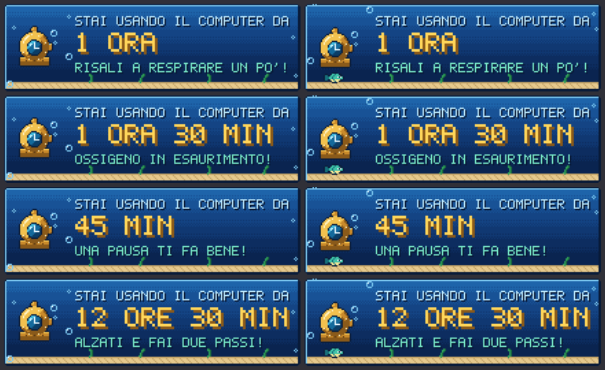
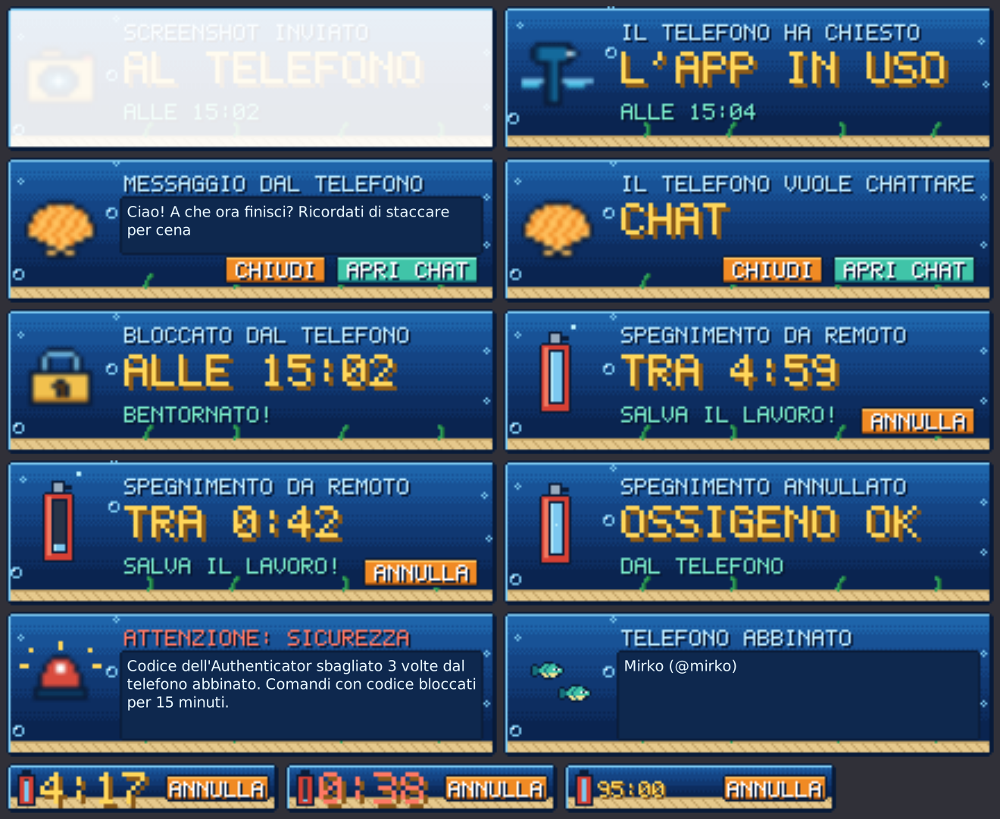

# WinUsage 1.3

Piccola utility per Windows 11 che vive nella tray e misura da quanto tempo stai usando il computer
(standby e schermo bloccato esclusi), con storico in SQLite separato per ogni utente. Grafica in pixel art a tema subacqueo.
Dalla 1.3 si può controllare dal telefono con un bot Telegram: screenshot, app in uso, chat, blocco, spegnimento
e messaggi di accensione/spegnimento.

## Come si usa

| Azione | Effetto |
|---|---|
| **Tasto sinistro** sull'icona | Popup con il tempo di utilizzo dall'avvio e i totali di oggi (Sistema, Browser, Steam); con il controllo remoto attivo, pulsante **CHAT** |
| **Tasto destro** sull'icona | Menu: **Storico 7 giorni...** / **Storico 30 giorni...** / **Configurazione...** / **Controllo remoto (Telegram)...** / **Manutenzione database...** / **Mostra messaggio di prova** / **Esci** |
| Passaggio del mouse | Tooltip "WinUsage - in uso da 1 ora e 30 minuti" |
| Soglia raggiunta | Messaggio in pixel art "Stai usando il computer da 2 ORE 30 MIN" (ogni N minuti, configurabile o disattivabile) |

### Messaggio di soglia in pixel art
Una finestrella animata (10 fotogrammi al secondo) in basso a destra: fondale a bande, elmo da palombaro con un
orologio nel vetro che dondola, bolle che salgono, un pesce che nuota, alghe che ondeggiano. Il testo è disegnato
con un font bitmap 5x7. Non ruba il focus, sparisce da sola dopo circa 11 secondi o con un clic. Se per qualche
motivo non si può vedere, resta comunque la normale notifica di Windows, mostrata insieme.
Tutta la grafica è originale: ispirata al tema (immersioni, oceano, ossigeno che finisce) senza usare personaggi
o elementi del gioco.

#### Schermo intero (giochi, Steam, Big Picture)
Il messaggio resta in primo piano sul monitor in cui stai giocando, senza mai prendere il focus (il gioco non
viene ridotto a icona né perde i comandi) e viene riportato in cima ogni mezzo secondo. Quando Windows segnala
uno schermo intero parte anche un breve jingle "8 bit". Funziona su giochi e Steam Big Picture in finestra senza
bordi (la modalità usata dalla maggior parte dei giochi attuali, comprese le "ottimizzazioni a schermo intero"
di Windows). Un gioco in schermo intero **esclusivo** (alcuni titoli DirectX 9 o più vecchi) impedisce a qualsiasi
altra finestra di apparire sopra: lì si sente il jingle, ma il messaggio si vede solo uscendo dal gioco. Disegnare
sopra un gioco richiederebbe di agganciarsi al gioco stesso, cosa che non facciamo (rischio con gli anti-cheat).
In *Configurazione* l'opzione si può disattivare: il messaggio viene allora rimandato a quando lo schermo intero finisce.

### Storico 7 e 30 giorni
Dal menu del tasto destro (o con i pulsanti *7 giorni* / *30 giorni* nella finestra): grafico a barre per giorno
(Sistema, Browser, Steam) e tabella con il totale del periodo, la media al giorno, la media nei soli giorni di
utilizzo e i valori di ogni giorno. Una linea tratteggiata indica la media del timer Sistema. Nella vista a 30 giorni
le barre sono più sottili, le date sono diradate e una linea leggera separa le settimane. I valori di oggi si
aggiornano ogni 5 secondi.

### Manutenzione database
Dal menu del tasto destro, **Manutenzione database...**:
- **Informazioni**: percorso, dimensione, spazio recuperabile, giorni registrati (dal... al...), sessioni, versione di SQLite.
- **Verifica integrità** (`PRAGMA integrity_check`).
- **Compatta** (`VACUUM`): recupera lo spazio lasciato dai dati eliminati.
- **Backup...**: copia completa e coerente del database in un file `.db` a scelta (`VACUUM INTO`; con un SQLite più
  vecchio, checkpoint del WAL e copia del file).
- **Esporta CSV...**: totali di ogni giorno in hh:mm:ss e in secondi, separatore `;` e UTF-8, pronto per Excel.
- **Apri cartella**: apre Esplora file sul database.
- **Elimina i dati più vecchi di N giorni** e **Azzera tutto lo storico**, sempre con conferma. La configurazione
  non viene toccata; dopo l'azzeramento i totali di oggi ripartono da zero, il tempo "da avvio" resta.
- **Conservazione automatica**: elimina da sola i giorni più vecchi di N giorni (minimo 31, così lo storico a 30
  giorni resta completo; disattivata di default). Si applica al salvataggio (con conferma se elimina qualcosa),
  all'avvio e poi ogni 6 ore.

Prima di ogni operazione i secondi ancora in memoria vengono scritti nel database.

### Controllo remoto via Telegram (1.3)
Dal menu del tasto destro, **Controllo remoto (Telegram)...**. Spento finché non lo configuri; il PC fa solo
connessioni HTTPS in uscita verso `api.telegram.org` (nessuna porta aperta, nessuna DLL in più).

**Configurazione in tre passi**
1. In Telegram apri @BotFather, `/newbot`, copia il token nella scheda *Collegamento* e premi *Verifica*.
   Usa un bot diverso per ogni PC e per ogni utente; consigliato `/setjoingroups` → Disable.
2. *Avvia abbinamento*: compare un codice di 8 caratteri valido 5 minuti. Scrivi al bot `/abbina CODICE`:
   il PC chiede conferma con un clic prima di accettare. Da quel momento il bot ascolta solo il tuo account
   e ignora tutti gli altri senza rispondere.
3. Scheda *Codice*: *Genera nuovo segreto*, inquadra il QR con un'app Authenticator e verifica un codice.

**Comandi**

| Comando | Effetto | Codice |
|---|---|---|
| `/stato` | Tempi di utilizzo di oggi e dall'avvio | no |
| `/app` | Applicazione in primo piano e da quanto, ultimo input, gioco Steam, schermo intero. Mai il titolo della finestra | no |
| `/screenshot [n] [hd]` | Cattura di tutti i monitor (o del monitor n); `hd` = PNG originale | no |
| `/chat` | Notifica sul PC con *APRI CHAT* e *CHIUDI*; il telefono sa se la chat viene aperta o rifiutata | no |
| `/blocca CODICE` | Blocca il PC (Win+L); allo sblocco compare "bloccato dal telefono" | sì |
| `/spegni CODICE [minuti]` | Spegnimento dopo un conto alla rovescia (5 minuti di default, da 1 a 120) | sì |
| `/annulla` | Ferma lo spegnimento | mai |
| `/sblocca CODICE` | Per 15 minuti `/blocca` e `/spegni` non chiedono il codice | — |
| `/stop` | Disattiva il controllo remoto (si riattiva solo dal PC) | no |
| testo senza `/` | Va nella chat del PC | no |

Quali comandi chiedono il codice si sceglie nella scheda *Comandi*.

**Chat**: dal pulsante *CHAT* del popup o con `/chat` dal telefono. Destinatario fisso (il telefono abbinato),
cronologia attiva di default: riaprendo la chat si ritrovano i messaggi già scambiati, anche quelli arrivati a chat
chiusa. La cronologia sta solo in memoria, mai sul disco, quindi sparisce quando WinUsage si chiude o il PC si
riavvia (e quando si rimuove l'abbinamento). Disattivandola (*Messaggi e notifiche* → *Chat*) i messaggi spariscono a
ogni chiusura della finestra. Un messaggio arrivato a chat chiusa compare come notifica con *APRI CHAT*. Chi sta al PC e non vuole chattare preme *CHIUDI* (sulla notifica o
nella finestra della chat, oppure chiude con la X): il telefono riceve "chat rifiutata" o "chat chiusa sul PC".
Se la richiesta resta senza risposta per 20 secondi, il telefono riceve "nessuno ha aperto la chat".

**Spegnimento**: sul PC compare la bombola d'ossigeno che si svuota con *ANNULLA*, poi un piccolo indicatore fisso
nell'angolo, poi di nuovo grande nell'ultimo minuto. Si annulla dal PC o con `/annulla`, e l'altro lato viene
avvisato. Durante il conto alla rovescia il PC non va in standby e lo schermo resta acceso (con lo standby moderno,
schermo spento vuol dire app congelate). A PC sbloccato lo spegnimento non è forzato: un documento non salvato lo
ferma (e il telefono lo viene a sapere). **A PC bloccato** non c'è nessuno che possa salvare, quindi alla scadenza le
app vengono chiuse senza salvare (la risposta a `/spegni` lo avvisa). Se il PC va in standby (pulsante, coperchio)
durante il conto alla rovescia, lo spegnimento viene annullato.

**Messaggi al telefono**: accensione (cioè l'accesso a Windows; "WinUsage avviato" se l'app parte a mano),
spegnimento/riavvio/disconnessione con i totali del giorno, chiusura di WinUsage, spegnimento improvviso (corrente,
blocco: riconosciuto al riavvio dall'ultimo segnale salvato). Standby e blocco schermo si possono attivare. Se allo
spegnimento la rete non c'è più, il messaggio parte al riavvio con l'indicazione "notificato in ritardo".

**Notifiche sul PC in pixel art**, tutte disattivabili tranne gli avvisi di sicurezza: screenshot inviato,
app in uso richiesta, messaggio dal telefono, bloccato da remoto, conto alla rovescia, spegnimento annullato,
abbinamento riuscito, avvisi di sicurezza (restano finché non si clicca). Con il controllo remoto attivo l'icona
nella tray ha un pallino verde.

**Sicurezza** (analisi completa nel documento di design del progetto):
- comandi eseguiti solo se Telegram li attribuisce all'account abbinato; ignorati gruppi, messaggi inoltrati,
  modificati, didascalie e messaggi via bot;
- `/blocca`, `/spegni` e `/sblocca` più vecchi di 2 minuti scartati (Telegram conserva i messaggi a PC spento),
  confrontando con l'ora del server Telegram e non con l'orologio del PC; i comandi che leggono soltanto (`/stato`,
  `/app`, `/screenshot`, `/chat`) si eseguono anche se arrivano in ritardo;
- codice TOTP monouso, 3 errori = comandi con codice bloccati per 15 minuti; limite di 20 comandi al minuto e di uno
  screenshot ogni 10 secondi;
- token, utente abbinato, segreto e regole in un unico blocco cifrato con DPAPI: se qualcuno lo modifica nel
  database il controllo remoto si spegne invece di obbedire a un altro account;
- il token non finisce mai nel log; un secondo programma che usa lo stesso token o un webhook impostato producono
  un avviso ("possibile token compromesso");
- screenshot solo in memoria, cancellati dalla chat dopo 10 minuti, mai con un gestore di password in primo piano;
- registro di ogni comando (anche rifiutato) nella scheda *Registro*, senza i codici.

Limiti da sapere: i bot di Telegram non hanno cifratura end-to-end, quindi Telegram può leggere comandi,
screenshot e orari; chi controlla il tuo account Telegram può vedere il tuo schermo (attiva la verifica in due
passaggi). Se perdi il telefono: @BotFather → `/revoke`. Se il PC lo usano altre persone, avvisale.

### Configurazione
- Avvio automatico con Windows (attivo di default)
- Notifica a intervalli regolari: attiva/disattiva e ogni quanti minuti (default 60)
- Timer Browser: attiva/disattiva e elenco dei processi considerati browser
- Timer Steam: attiva/disattiva

## Installare

`dist\WinUsage-Setup-1.4.0.exe`: installer per l'utente corrente (nessun permesso di amministratore).
Installa in `%LOCALAPPDATA%\Programs\WinUsage`, crea il collegamento nel menu Start e si registra in
*Impostazioni > App > App installate*. Un aggiornamento chiude da solo la versione in esecuzione (salvando i dati).
La disinstallazione rimuove app, collegamento e avvio automatico, e chiede se eliminare anche storico e
configurazione dell'utente (`%LOCALAPPDATA%\WinUsage`, per default no). Supporta `/S` per l'installazione silenziosa.

Essendo per-utente, ogni utente Windows che vuole la misura deve installare l'app (o avviarla dalla stessa
cartella): ognuno ha poi il proprio storico. Windows SmartScreen può mostrare un avviso perché l'installer non è
firmato digitalmente.

Per rigenerare l'installer: `build-installer.bat` (Windows, richiede NSIS) oppure `sh build-installer.sh` (Linux).

## Compilare

**Su Windows** (non serve installare nulla, usa il compilatore C# incluso in Windows):

    build.bat

**Su Linux/macOS** con Mono (`mono-mcs`, `mono-devel`, `libmono-system-windows-forms4.0-cil`). Lo script compila
contro gli assembly di riferimento di .NET Framework 4.8 inclusi in `mono-devel` (`/usr/lib/mono/4.8-api`), non contro
le librerie di Mono: alcune classi stanno in DLL diverse e l'exe si chiuderebbe all'avvio su Windows
(è successo con la 1.3.0, sistemato nella 1.3.1):

    bash build-mono.sh

Risultato: `bin\WinUsage.exe` (circa 350 KB con l'icona, richiede .NET Framework 4.8, già presente in Windows 11).
Copialo dove vuoi e avvialo: al primo avvio si registra per l'avvio automatico.
Se sposti l'exe, al lancio successivo l'avvio automatico viene riallineato al nuovo percorso.

## Come funziona

- **Timer "Sistema"**: parte all'avvio dell'app (che con l'avvio automatico coincide con l'accesso a Windows).
  Un tick al secondo; se tra due tick passano più di 5 secondi il PC era in standby/ibernazione
  (o è stato cambiato l'orologio) e quell'intervallo **non viene contato**. Sugli eventi di alimentazione
  Suspend/Resume i dati vengono salvati e il riferimento temporale azzerato.
- **Schermo bloccato**: con Win+L, il blocco automatico o il salvaschermo il conteggio si ferma e riprende allo
  sblocco. Oltre agli eventi di sessione di Windows, ogni secondo l'app controlla se il desktop che riceve l'input
  è quello della schermata di blocco, così il conteggio non resta acceso se un evento va perso. Se la soglia
  scatta in quel momento, il messaggio viene mostrato allo sblocco.
- **Cambio utente rapido**: quando la sessione viene disconnessa il conteggio si ferma, perché in quel momento
  il PC lo sta usando un altro utente.
- **Per utente**: l'app è per-utente. Database e configurazione sono in
  `%LOCALAPPDATA%\WinUsage\usage.db` (profilo di ciascun utente), l'avvio automatico è in `HKCU\...\Run`.
  Non servono privilegi di amministratore. Ogni utente che vuole la misura deve avviare l'app una volta.
- **SQLite**: usa `winsqlite3.dll`, la libreria SQLite già inclusa in Windows 10/11, quindi nessuna DLL o
  pacchetto da distribuire. Tabelle: `settings` (anche `retention_days` e le impostazioni `remote_*`),
  `usage_daily(day, timer, seconds)`, `sessions(id, started_utc, last_seen_utc, active_seconds, ended_clean)`,
  e per il controllo remoto `remote_outbox` (messaggi in attesa), `remote_log` (registro dei comandi, incluso
  nella pulizia dello storico) e `remote_delete` (screenshot da cancellare dalla chat). Salvataggio ogni 30 secondi,
  prima dello standby e all'uscita/spegnimento.
- Log di eventuali errori: `%LOCALAPPDATA%\WinUsage\winusage.log`.

## I tre timer: è possibile? Sì

| Timer | Come viene misurato | Precisione / limiti |
|---|---|---|
| **Sistema** | Tempo con PC acceso e sessione attiva, standby e schermo bloccato esclusi | Conta dall'avvio dell'app. Se la avvii a mano dopo ore dall'accensione, parte da zero. Con "Avvio rapido" di Windows lo spegnimento è un'ibernazione del kernel, ma ogni accesso riavvia l'app, quindi la sessione riparte comunque da zero |
| **Browser** | Secondi in cui la finestra in **primo piano** appartiene a un processo browser (chrome, msedge, firefox, brave, opera, vivaldi... lista modificabile) | Non conta le schede in background, ma conta una pagina rimasta in primo piano mentre sei lontano dal PC (es. un video) |
| **Steam** | Secondi in cui Steam ha un **gioco in esecuzione** (valore `RunningAppID` nel registro dell'utente, verificato con la presenza di `steam.exe`) oppure il client Steam è in primo piano | Conta il gioco anche se la sua finestra non è in primo piano; non distingue quale gioco |

Tutti e tre sono salvati per giorno nel database. Browser e Steam non richiedono hook, driver o permessi speciali.

## Stato della verifica

- Compilato senza errori né avvisi con `mcs -langversion:5`, cioè con il sottoinsieme di C# del compilatore
  integrato in Windows.
- `tests/run-tests.sh`: 245 controlli sulla logica con tempo simulato (soglie, standby con e senza eventi, schermo bloccato,
  cambio utente, mezzanotte, persistenza, storico a 7 e 30 giorni, manutenzione: informazioni, verifica, pulizia,
  compattazione, backup, CSV, azzeramento, conservazione) su SQLite reale. Dalla 1.3 anche il controllo remoto:
  TOTP con i vettori della RFC 6238, Base32, QR, configurazione cifrata e alterata, coda in uscita, spegnimento
  improvviso e aggiornamento dalla 1.2, lettura degli update di Telegram, abbinamento (codice scaduto, tentativi,
  conferma negata), mittenti e messaggi ignorati, comandi scaduti, codici giusti/errati/riusati, blocco dopo 3
  errori, sessione /sblocca, minuti di /spegni, limiti di frequenza, conto alla rovescia e standby.
- Controllo remoto provato da capo a fondo con Mono contro un server Telegram finto (lettura dei messaggi, risposte,
  screenshot inviato in multipart, messaggi di accensione, spegnimento improvviso e spegnimento). Il QR mostrato
  nella finestra *Controllo remoto* è stato decodificato con OpenCV.
- Messaggio di soglia, notifiche del controllo remoto e grafico dello storico disegnati su PNG con Mono e controllati
  a occhio (`docs/`).
- L'installer si compila senza avvisi con NSIS 3.09.
- La 1.3.0 su Windows si chiudeva all'avvio (`TypeLoadException` su `Queue<T>`, compilata contro le librerie di Mono):
  dalla 1.3.1 si compila contro gli assembly di riferimento di .NET 4.8 e i riferimenti dell'exe sono stati confrontati
  con quelli della build sbagliata (era l'unica differenza).
- La 1.3.1 su Windows 11 non riusciva a collegarsi a Telegram ("Rete: ReceiveFailure"): dalla 1.3.2 la connessione
  usa TLS 1.2 esplicito invece della scelta di sistema, e gli errori di rete riportano la causa completa (anche nel log).
- 1.4.0, dopo la prova su Windows 11: lo screenshot copriva solo la parte in alto a sinistra (l'exe compilato con Mono
  non contiene il manifest, quindi l'app non è DPI-aware e con lo schermo scalato Windows le dava coordinate ridotte);
  i comandi a volte andavano ripetuti (lettura appesa su connessioni morte, attese fino a 5 minuti dopo un errore di
  rete, comandi in ritardo scartati); `/spegni` a PC bloccato non funzionava (il timer fermo veniva scambiato per
  uno standby, ed `ExitWindowsEx` non spegne una sessione bloccata).
- **Non ancora provato su un Windows reale**: tray, popup, finestre, animazione e posizione del toast,
  notifiche, eventi di alimentazione, `winsqlite3.dll`, registro e l'esecuzione dell'installer.
  Lo stesso vale per il comportamento a schermo intero (`SHQueryUserNotificationState`, `SetWindowPos`, audio) e,
  per il controllo remoto, le correzioni della 1.4.0 (cattura in pixel fisici, `InitiateShutdown` a PC bloccato,
  PC tenuto sveglio durante il conto alla rovescia, lettura più robusta), i pulsanti *CHIUDI* e la cronologia della chat.
  `bin/WinUsage.exe` incluso è stato compilato con Mono. Se qualcosa non va, controlla `winusage.log`.

## Struttura

    src/Core.cs          formattazione, impostazioni, accesso al database e manutenzione
    src/Art.cs           font pixel 5x7, scena animata del messaggio di soglia
    src/Sprites.cs       sprite (generato da tools/make_art.py)
    src/ToastForm.cs     finestra del messaggio di soglia
    src/ChipTune.cs      jingle 8 bit generato in memoria
    src/History.cs       dati e grafico dello storico
    src/HistoryForm.cs   finestra "Storico" (7 o 30 giorni)
    src/MaintenanceForm.cs finestra "Manutenzione database"
    src/Db.cs            wrapper P/Invoke su winsqlite3.dll
    src/UsageTracker.cs  motore di conteggio (standby, soglie, giorni)
    src/Probe.cs         finestra in primo piano, stato di Steam, avvio automatico
    src/TrayContext.cs   icona nella tray, menu, notifiche, eventi di sistema
    src/PopupForm.cs     popup del tasto sinistro
    src/SettingsForm.cs  finestra di configurazione
    src/RemoteCore.cs    controllo remoto: TOTP, configurazione cifrata, coda, regole di sicurezza (RemoteController)
    src/Telegram.cs      client minimo della Bot API (HTTPS, JSON del framework)
    src/Qr.cs            generatore di QR code (per l'app Authenticator)
    src/RemoteService.cs collega controller, rete (2 thread), azioni, notifiche, chat; messaggi di accensione/spegnimento
    src/RemoteActions.cs app in uso, screenshot, blocco, spegnimento (API di Windows)
    src/NotifyArt.cs     notifiche e badge del conto alla rovescia in pixel art
    src/NotifyForm.cs    finestre delle notifiche, coda con priorità, badge
    src/RemoteSprites.cs sprite 16x16 delle notifiche
    src/RemoteChatForm.cs finestra di chat e pulsante pixel art
    src/RemoteSettingsForm.cs finestra "Controllo remoto"
    tools/make_art.py    genera icona, sprite e immagini dell'installer (Pillow)
    installer/           script NSIS e immagini
    docs/                anteprime
    tests/               collaudo della logica (Mono); render-preview.sh disegna toast, notifiche e grafico su PNG

## Sviluppo con l'AI
Questo progetto è stato sviluppato con l'assistenza di Claude (Anthropic): codice, test, script che genera la
pixel art e installer sono stati scritti insieme a Claude e provati dall'autore. I commit riportano il
trailer `Co-Authored-By`.

## Idee per dopo
Ripristino da un backup, installazione per tutti gli utenti, firma del codice. Controllo remoto: `/riavvia`,
`/sospendi`, `/muto`, `/chiudi <app>`, `/stato` come immagine pixel art, inoltro dei messaggi di soglia.
