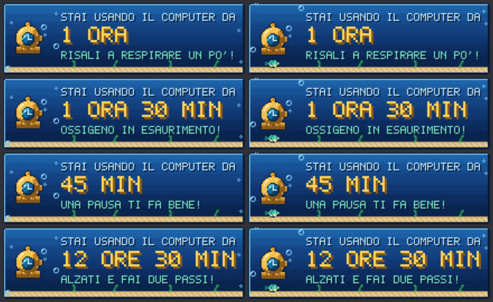
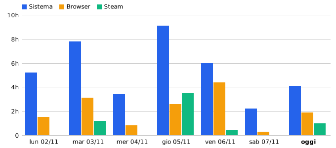

# WinUsage 1.1

Piccola utility per Windows 11 che vive nella tray e misura da quanto tempo stai usando il computer
(standby escluso), con storico in SQLite separato per ogni utente. Grafica in pixel art a tema subacqueo.

## Come si usa

| Azione | Effetto |
|---|---|
| **Tasto sinistro** sull'icona | Popup con il tempo di utilizzo dall'avvio e i totali di oggi (Sistema, Browser, Steam) |
| **Tasto destro** sull'icona | Menu: **Storico 7 giorni...** / **Configurazione...** / **Esci** |
| Passaggio del mouse | Tooltip "WinUsage - in uso da 1 ora e 30 minuti" |
| Soglia raggiunta | Messaggio in pixel art "Stai usando il computer da 2 ORE 30 MIN" (ogni N minuti, configurabile o disattivabile) |

### Messaggio di soglia in pixel art
Una finestrella animata (10 fotogrammi al secondo) in basso a destra: fondale a bande, elmo da palombaro con un
orologio nel vetro che dondola, bolle che salgono, un pesce che nuota, alghe che ondeggiano. Il testo è disegnato
con un font bitmap 5x7. Non ruba il focus, sparisce da sola dopo circa 11 secondi o con un clic. Se per qualche
motivo non si può mostrare, ripiega sulla normale notifica di Windows.
Tutta la grafica è originale: ispirata al tema (immersioni, oceano, ossigeno che finisce) senza usare personaggi
o elementi del gioco.

#### Schermo intero (giochi, Steam, Big Picture)
Il messaggio resta in primo piano sul monitor in cui stai giocando, senza mai prendere il focus (il gioco non
viene ridotto a icona né perde i comandi) e viene riportato in cima ogni mezzo secondo. Quando Windows segnala
uno schermo intero parte anche un breve jingle "8 bit". Funziona su giochi e Steam Big Picture in finestra senza
bordi (la modalità usata dalla maggior parte dei giochi attuali, comprese le "ottimizzazioni a schermo intero"
di Windows). Un gioco in schermo intero **esclusivo** (alcuni titoli DirectX 9 o più vecchi) impedisce a qualsiasi
altra finestra di apparire sopra: lì si sente il jingle, ma il messaggio si vede solo uscendo dal gioco. Disegnare
sopra un gioco richiederebbe di agganciarsi al gioco stesso, cosa che non facciamo (rischio con gli anti-cheat).
In *Configurazione* l'opzione si può disattivare: il messaggio viene allora rimandato a quando lo schermo intero finisce.

### Storico 7 giorni
Dal menu del tasto destro: grafico a barre per giorno (Sistema, Browser, Steam) e tabella con i totali, il
totale dei 7 giorni e la media giornaliera. I valori di oggi si aggiornano ogni 5 secondi.

### Configurazione
- Avvio automatico con Windows (attivo di default)
- Notifica a intervalli regolari: attiva/disattiva e ogni quanti minuti (default 60)
- Timer Browser: attiva/disattiva e elenco dei processi considerati browser
- Timer Steam: attiva/disattiva

## Installare

`dist\WinUsage-Setup-1.1.0.exe`: installer per l'utente corrente (nessun permesso di amministratore).
Installa in `%LOCALAPPDATA%\Programs\WinUsage`, crea il collegamento nel menu Start e si registra in
*Impostazioni > App > App installate*. Un aggiornamento chiude da solo la versione in esecuzione (salvando i dati).
La disinstallazione rimuove app, collegamento e avvio automatico, e chiede se eliminare anche storico e
configurazione dell'utente (`%LOCALAPPDATA%\WinUsage`, per default no). Supporta `/S` per l'installazione silenziosa.

Essendo per-utente, ogni utente Windows che vuole la misura deve installare l'app (o avviarla dalla stessa
cartella): ognuno ha poi il proprio storico. Windows SmartScreen può mostrare un avviso perché l'installer non è
firmato digitalmente.

Per rigenerare l'installer: `build-installer.bat` (Windows, richiede NSIS) oppure `sh build-installer.sh` (Linux).

## Compilare

**Su Windows** (non serve installare nulla, usa il compilatore C# incluso in Windows):

    build.bat

**Su Linux/macOS** con Mono (`mono-mcs`, `libmono-system-windows-forms4.0-cil`):

    bash build-mono.sh

Risultato: `bin\WinUsage.exe` (circa 100 KB, richiede .NET Framework 4.8, già presente in Windows 11).
Copialo dove vuoi e avvialo: al primo avvio si registra per l'avvio automatico.
Se sposti l'exe, al lancio successivo l'avvio automatico viene riallineato al nuovo percorso.

## Come funziona

- **Timer "Sistema"**: parte all'avvio dell'app (che con l'avvio automatico coincide con l'accesso a Windows).
  Un tick al secondo; se tra due tick passano più di 5 secondi il PC era in standby/ibernazione
  (o è stato cambiato l'orologio) e quell'intervallo **non viene contato**. Sugli eventi di alimentazione
  Suspend/Resume i dati vengono salvati e il riferimento temporale azzerato.
- **Cambio utente rapido**: quando la sessione viene disconnessa il conteggio si ferma, perché in quel momento
  il PC lo sta usando un altro utente.
- **Per utente**: l'app è per-utente. Database e configurazione sono in
  `%LOCALAPPDATA%\WinUsage\usage.db` (profilo di ciascun utente), l'avvio automatico è in `HKCU\...\Run`.
  Non servono privilegi di amministratore. Ogni utente che vuole la misura deve avviare l'app una volta.
- **SQLite**: usa `winsqlite3.dll`, la libreria SQLite già inclusa in Windows 10/11, quindi nessuna DLL o
  pacchetto da distribuire. Tabelle: `settings`, `usage_daily(day, timer, seconds)`, `sessions(id, started_utc,
  last_seen_utc, active_seconds)`. Salvataggio ogni 30 secondi, prima dello standby e all'uscita/spegnimento.
- Log di eventuali errori: `%LOCALAPPDATA%\WinUsage\winusage.log`.

## I tre timer: è possibile? Sì

| Timer | Come viene misurato | Precisione / limiti |
|---|---|---|
| **Sistema** | Tempo con PC acceso e sessione attiva, standby escluso | Conta dall'avvio dell'app. Se la avvii a mano dopo ore dall'accensione, parte da zero. Con "Avvio rapido" di Windows lo spegnimento è un'ibernazione del kernel, ma ogni accesso riavvia l'app, quindi la sessione riparte comunque da zero |
| **Browser** | Secondi in cui la finestra in **primo piano** appartiene a un processo browser (chrome, msedge, firefox, brave, opera, vivaldi... lista modificabile) | Non conta le schede in background, ma conta una pagina rimasta in primo piano mentre sei lontano dal PC (es. un video) |
| **Steam** | Secondi in cui Steam ha un **gioco in esecuzione** (valore `RunningAppID` nel registro dell'utente, verificato con la presenza di `steam.exe`) oppure il client Steam è in primo piano | Conta il gioco anche se la sua finestra non è in primo piano; non distingue quale gioco |

Tutti e tre sono salvati per giorno nel database. Browser e Steam non richiedono hook, driver o permessi speciali.

## Stato della verifica

- Compilato senza errori né avvisi con `mcs -langversion:5`, cioè con il sottoinsieme di C# del compilatore
  integrato in Windows.
- `tests/run-tests.sh`: 52 controlli sulla logica con tempo simulato (soglie, standby con e senza eventi,
  cambio utente, mezzanotte, persistenza, storico a 7 giorni) su SQLite reale.
- Messaggio di soglia e grafico dello storico disegnati su PNG con Mono e controllati a occhio (`docs/`).
- L'installer si compila senza avvisi con NSIS 3.09.
- **Non ancora provato su un Windows reale**: tray, popup, finestre, animazione e posizione del toast,
  notifiche, eventi di alimentazione, `winsqlite3.dll`, registro e l'esecuzione dell'installer.
  Lo stesso vale per il comportamento a schermo intero (`SHQueryUserNotificationState`, `SetWindowPos`, audio).
  `bin/WinUsage.exe` incluso è stato compilato con Mono. Se qualcosa non va, controlla `winusage.log`.

## Struttura

    src/Core.cs          formattazione, impostazioni, accesso al database
    src/Art.cs           font pixel 5x7, scena animata del messaggio di soglia
    src/Sprites.cs       sprite (generato da tools/make_art.py)
    src/ToastForm.cs     finestra del messaggio di soglia
    src/ChipTune.cs      jingle 8 bit generato in memoria
    src/History.cs       dati e grafico dello storico
    src/HistoryForm.cs   finestra "Storico 7 giorni"
    src/Db.cs            wrapper P/Invoke su winsqlite3.dll
    src/UsageTracker.cs  motore di conteggio (standby, soglie, giorni)
    src/Probe.cs         finestra in primo piano, stato di Steam, avvio automatico
    src/TrayContext.cs   icona nella tray, menu, notifiche, eventi di sistema
    src/PopupForm.cs     popup del tasto sinistro
    src/SettingsForm.cs  finestra di configurazione
    tools/make_art.py    genera icona, sprite e immagini dell'installer (Pillow)
    installer/           script NSIS e immagini
    docs/                anteprime
    tests/               collaudo della logica (Mono); render-preview.sh disegna toast e grafico su PNG

## Idee per dopo
Storico a 30 giorni, esportazione CSV, installazione per tutti gli utenti, firma del codice.
